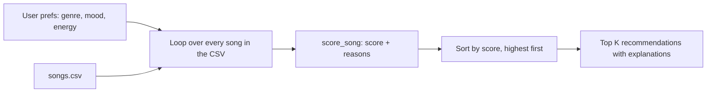

# 🎵 Music Recommender Simulation

## Project Summary

This project is a small, command-line music recommender called **VibeFinder 1.0**. It loads a 20-song catalog from a CSV file, compares every song to a user's "taste profile" (favorite genre, favorite mood, and target energy), gives each song a score out of 4.0, and prints the top 5 with the reasons for each score. It is a **content-based** recommender: it only looks at song attributes, never at what other users did.

---

## How The System Works

### How real platforms do it (short version)

Real apps like Spotify and YouTube mix two ideas. **Collaborative filtering** says "people who liked what you liked also liked this", so it uses other users' behavior (likes, skips, playlists, listening time). **Content-based filtering** says "this song sounds like songs you like", so it uses song attributes (tempo, energy, mood, genre). Real systems blend both at huge scale, and they learn the weights from data. My version is content-based only, and I set the weights by hand. It prioritizes **genre first, then mood, then how close the energy is** to what the user wants.

### Features used

**`Song`** (from `data/songs.csv`): `id`, `title`, `artist`, `genre`, `mood`, `energy` (0.0 to 1.0), `tempo_bpm`, `valence`, `danceability`, `acousticness`.
The scoring currently uses **genre, mood, and energy**. The other columns are loaded and available for future experiments.

**`UserProfile`**: `favorite_genre`, `favorite_mood`, `target_energy`, `likes_acoustic`. The dictionary version used in `main.py` is `{"genre": ..., "mood": ..., "energy": ...}`.

### Algorithm Recipe

**Scoring Rule** (judges ONE song, max 4.0 points):

| Rule | Points |
|---|---|
| Genre matches exactly | +2.0 |
| Mood matches exactly | +1.0 |
| Energy closeness | up to +1.0, calculated as `1.0 - abs(song_energy - target_energy)` |

The energy rule rewards songs that are *close* to the target. A song at 0.82 energy for a 0.80 target gets 0.98 points. A song at 0.18 gets only 0.28. It does not simply favor "higher" or "lower" energy.

**Ranking Rule** (judges the WHOLE list): run the scoring rule on every song, sort by score from highest to lowest, and keep the top `k`. We need both because the scoring rule only answers "how good is this one song?", while the ranking rule answers "which songs are best out of all of them?".

### Data flow



### Expected biases

- Genre is worth twice as much as mood, so the system may bury a great mood-and-energy match just because its genre is different.
- Genre and mood are exact-match only. "Indie pop" gets no credit for being close to "pop", and "chill" gets no credit for being close to "relaxed".
- With only one or two songs per genre, a genre match can dominate the top of the list.

---

## Getting Started

### Setup

1. Create a virtual environment (optional but recommended):

   ```bash
   python -m venv .venv
   source .venv/bin/activate      # Mac or Linux
   .venv\Scripts\activate         # Windows
   ```

2. Install dependencies

```bash
pip install -r requirements.txt
```

3. Run the app (from the project root):

```bash
python -m src.main
```

### Running Tests

```bash
pytest
```

The tests in `tests/test_recommender.py` check sorting, explanations, CSV number conversion, the maximum score, and that closer energy scores higher.

---

## Sample Recommendation Output

Default "pop / happy / energy 0.8" profile, produced by `python -m src.main`:

```text
=
```

The other six profiles are in the Experiments section and in `model_card.md`.

---

## Experiments You Tried

### Stress test with different profiles

I tested three normal profiles (High-Energy Pop, Chill Lofi, Deep Intense Rock) and three tricky ones (conflicting preferences, a genre that is not in the catalog, and a middle-of-the-road user). Full output:

**High-Energy Pop**

```text
=
```

**Chill Lofi**

```text
=
```

**Deep Intense Rock**

```text
=
```

**Conflicting (high energy + sad)**

```text
=
```

**Genre not in catalog (k-pop)**

```text
=
```

**Middle of the road**

```text
=
```

### Weight shift experiment (double energy, halve genre)

I changed the weights from `genre 2.0 / mood 1.0 / energy 1.0` to `genre 1.0 / mood 1.0 / energy 2.0`. The maximum score is still 4.0, so the math stays valid and scores are comparable.

```text
=
```

```text
=
```

```text
=
```

```text
=
```

```text
=
```

```text
=
```

```text
=
```

```text
=
```

```text
=
```

```text
=
```

```text
=
```

```text
=
```

```text
=
```

```text
=
```

```text
=
```

```text
=
```

```text
=
```

```text
=
```

```text
=
```

```text
=
```

```text
=
```

```text
=
```

```text
=
```

```text
=
```

```text
=
```

```text
=
```

```text
=
```

```text
=
```

```text
=
```

```text
=
```

```text
=
```

```text
=
```

```text
=
```

```text
=
```

```text
=
```

```text
=
```

```text
=
```

```text
=
```

```text
=
```

```text
=
```

```text
=
```

```text
=
```

```text
=
```

```text
=
```

```text
=
```

```text
=
```

```text
=
```

```text
=
```

```text
=
```

```text
=
```

```text
=
```

```text
=
```

```text
=
```

```text
=
```

```text
=
```

```text
=
```

```text
=
```

```text
=
```

```text
=
```

```text
=
```

```text
=
```

```text
=
```

```text
=
```

```text
=
Profile: Default Pop/Happy (shifted weights)
Prefs:   genre=pop, mood=happy, energy=0.8
----------------------------------------------------------------
1. Sunrise City by Neon Echo  |  Score: 3.96 / 4.00
     - genre match: pop (+1.0)
     - mood match: happy (+1.0)
     - energy 0.82 vs target 0.80 (+1.96)
2. Rooftop Lights by Indigo Parade  |  Score: 2.92 / 4.00
     - mood match: happy (+1.0)
     - energy 0.76 vs target 0.80 (+1.92)
3. Gym Hero by Max Pulse  |  Score: 2.74 / 4.00
     - genre match: pop (+1.0)
     - energy 0.93 vs target 0.80 (+1.74)
4. Block Party Anthem by Deuce Kingston  |  Score: 2.00 / 4.00
     - energy 0.80 vs target 0.80 (+2.00)
5. Night Drive Loop by Neon Echo  |  Score: 1.90 / 4.00
     - energy 0.75 vs target 0.80 (+1.90)
```

```text
=
```

```text
=
```

```text
=
```

```text
=
```

```text
=
```

```text
=
```

```text
=
```

```text
=
```

```text
=
```

```text
=
```

```text
=
```

```text
=
```

```text
=
```

```text
=
```

```text
=
```

```text
=
```

```text
=
```

```text
=
```

```text
=
```

```text
=
```

```text
=
```

```text
=
```

```text
=
```

```text
=
```

```text
=
```

```text
=
```

```text
=
```

```text
=
```

```text
=
```

```text
=
```

```text
=
```

```text
=
```

```text
=
```

```text
=
```

```text
=
```

```text
=
```

```text
=
```

```text
=
```

```text
=
```

```text
=
```

```text
=
```

```text
=
```

```text
=
```

```text
=
```

```text
=
```

```text
=
```

```text
=
```

```text
=
```

```text
=
```

```text
=
```

```text
=
```

```text
=
```

```text
=
```

```text
=
```

```text
=
```

```text
=
```

```text
=
```

```text
=
```

```text
=
```

```text
=
```

```text
=
```

```text
=
```

```text
=
```

```text
=
Profile: High-Energy Pop (shifted weights)
Prefs:   genre=pop, mood=intense, energy=0.93
----------------------------------------------------------------
1. Gym Hero by Max Pulse  |  Score: 4.00 / 4.00
     - genre match: pop (+1.0)
     - mood match: intense (+1.0)
     - energy 0.93 vs target 0.93 (+2.00)
2. Storm Runner by Voltline  |  Score: 2.96 / 4.00
     - mood match: intense (+1.0)
     - energy 0.91 vs target 0.93 (+1.96)
3. Sunrise City by Neon Echo  |  Score: 2.78 / 4.00
     - genre match: pop (+1.0)
     - energy 0.82 vs target 0.93 (+1.78)
4. Iron Cathedral by Black Meridian  |  Score: 1.92 / 4.00
     - energy 0.97 vs target 0.93 (+1.92)
5. Neon Cathedral by Violet Static  |  Score: 1.90 / 4.00
     - energy 0.88 vs target 0.93 (+1.90)
```

```text
=
```

```text
=
```

```text
=
```

```text
=
```

```text
=
```

```text
=
```

```text
=
```

```text
=
```

```text
=
```

```text
=
```

```text
=
```

```text
=
```

```text
=
```

```text
=
```

```text
=
```

```text
=
```

```text
=
```

```text
=
```

```text
=
```

```text
=
```

```text
=
```

```text
=
```

```text
=
```

```text
=
```

```text
=
```

```text
=
```

```text
=
```

```text
=
```

```text
=
```

```text
=
```

```text
=
```

```text
=
```

```text
=
```

```text
=
```

```text
=
```

```text
=
```

```text
=
```

```text
=
```

```text
=
```

```text
=
```

```text
=
```

```text
=
```

```text
=
```

```text
=
```

```text
=
```

```text
=
```

```text
=
```

```text
=
```

```text
=
```

```text
=
```

```text
=
```

```text
=
```

```text
=
```

```text
=
```

```text
=
```

```text
=
```

```text
=
```

```text
=
```

```text
=
```

```text
=
```

```text
=
```

```text
=
```

```text
=
```

```text
=
Profile: Chill Lofi (shifted weights)
Prefs:   genre=lofi, mood=chill, energy=0.35
----------------------------------------------------------------
1. Library Rain by Paper Lanterns  |  Score: 4.00 / 4.00
     - genre match: lofi (+1.0)
     - mood match: chill (+1.0)
     - energy 0.35 vs target 0.35 (+2.00)
2. Midnight Coding by LoRoom  |  Score: 3.86 / 4.00
     - genre match: lofi (+1.0)
     - mood match: chill (+1.0)
     - energy 0.42 vs target 0.35 (+1.86)
3. Focus Flow by LoRoom  |  Score: 2.90 / 4.00
     - genre match: lofi (+1.0)
     - energy 0.40 vs target 0.35 (+1.90)
4. Spacewalk Thoughts by Orbit Bloom  |  Score: 2.86 / 4.00
     - mood match: chill (+1.0)
     - energy 0.28 vs target 0.35 (+1.86)
5. Coffee Shop Stories by Slow Stereo  |  Score: 1.96 / 4.00
     - energy 0.37 vs target 0.35 (+1.96)
```

**What changed:**

- **Default Pop/Happy:** *Rooftop Lights* (indie pop, happy, energy 0.76) jumped from 3rd to 2nd and now beats *Gym Hero*. Before, *Gym Hero* won on its pop genre match alone. With less weight on genre, a song that matches the mood and sits close to the energy target wins. This is more accurate for a "happy" listener.
- **High-Energy Pop:** *Storm Runner* (rock) moved from 3rd to 2nd, ahead of *Sunrise City* (pop). Energy now matters more than the genre label.
- **Chill Lofi:** The top 3 stayed the same, but *Spacewalk Thoughts* (ambient) moved much closer to *Focus Flow*. Lofi fans would likely enjoy ambient, so this feels more natural.

**Verdict:** the shifted weights felt *more accurate* for the happy-pop listener and *different but reasonable* for the others.

---

## Limitations and Risks

- It only works on a tiny catalog (20 songs), and many genres have just one song.
- It does not understand lyrics, language, artist, or release year.
- Genre and mood are exact-match only, so near-matches get zero credit.
- It can over-favor genre: a classical song with the wrong energy still ranked first for a "high-energy, sad" user.
- It has no memory of what a user has already heard, so it would keep repeating the same songs.

More detail is in the model card.

---

## Reflection

Read and complete `model_card.md`:

[**Model Card**](model_card.md)

> ✏️ **YOU: rewrite this in your own words before submitting.** Draft below.

I learned that a recommender is really just "score every item, then sort". The hard part is deciding what the score should reward. Turning a feeling like "vibe" into three numbers and a few rules made me see how much a designer's choices shape what people hear. Weights like genre = 2.0 are opinions, not facts, and changing one number changed the top results.

Bias can show up quietly. My system treats genre as twice as important as mood, so it favors people whose taste fits neatly into one genre label. People with mixed or unusual taste (like "sad but high energy") get weaker, odder results. In a real app with millions of users, small choices like this could decide which artists get heard.
